# Cubrí Seguros · Contratación digital de seguro de celular

Trabajo práctico de **Diseño UXUI 2026** · Licenciatura en Sistemas de Información (FCyT).
Front-end de un checkout de contratación de seguros: el usuario cotiza su celular, elige un plan,
carga sus datos, paga (simulado) y recibe su número de póliza.

**Sitio publicado:** https://USUARIO.github.io/cubri-seguros/ <!-- reemplazar USUARIO por tu usuario de GitHub -->

## Cómo correrlo

No requiere Node ni compilación. Hace falta conexión a internet (Tailwind, Basecoat y la fuente Inter se cargan por CDN).

1. Clonar el repositorio: `git clone https://github.com/USUARIO/cubri-seguros.git`
2. Abrir la carpeta en **VS Code** y usar la extensión **Live Server** (clic derecho sobre `index.html` → *Open with Live Server*).
   - Alternativa sin VS Code: `npx serve` dentro de la carpeta.
3. **No abrir `index.html` con doble clic**: el `fetch` de `data/planes.json` falla con `file://`.

## Stack

HTML5 · Tailwind CSS v4 (CDN) · Basecoat UI 1.1.0 (solo CSS) · JavaScript vanilla con módulos ES · tipografía Inter.
Sin frameworks, sin jQuery y sin librerías de validación.

## Estructura

```
cubri-seguros/
├── index.html            una sola página: cada paso es una <section data-paso="N">
├── css/
│   ├── tokens.css        variables de color y tipografía del Figma (sobrescriben a Basecoat)
│   └── componentes.css   ajustes sobre Basecoat y piezas propias (stepper, chips, cards de plan)
├── data/planes.json      catálogo de planes (se carga con fetch)
└── js/
    ├── app.js            arranque, eventos y navegación
    ├── estado.js         objeto `solicitud` + funciones para modificarlo
    ├── render.js         pinta cada paso a partir del estado
    ├── validaciones.js   funciones puras: reciben un valor y devuelven el error o null
    ├── cotizador.js      calcularCuota() y formato de moneda
    └── pago.js           simularPago() y generarPoliza()
```

## Cómo funciona

- **Un único estado.** Toda la información del flujo vive en el objeto `solicitud`. El DOM solo muestra lo que dice
  el estado: cada evento modifica `solicitud` y después se llama a `render()`.
- **Pasos con `hidden`.** `render()` muestra la `<section>` del paso actual y oculta las demás; los inputs se rellenan
  desde el estado, por eso "Volver" nunca pierde datos.
- **Resumen generado una sola vez.** Hay un único `<aside id="resumen">`: card lateral en desktop, y en mobile aparece
  arriba del formulario en el paso 4 (más una barra corta sobre el botón en el paso 2).
- **Una sola función de cálculo.** `cuotaDe()` en `estado.js` es el único lugar que llama a `calcularCuota()`, así el
  precio de las cards y el del resumen no pueden diferir.
- **Validaciones como funciones puras.** Cada regla devuelve un mensaje o `null`. Los errores no se guardan: se
  calculan desde el estado. El error de un campo se muestra al salir de él (`blur`) y se revalida todo al intentar avanzar.
- **Responsive mobile first.** Estilos base para 390 px y prefijo `lg:` desde 1024 px (checkout en dos columnas con
  resumen de 380 px).

## Reglas de negocio y casos de prueba

`cuota = Math.round(valor × tasaAnual / 12 × factorAntiguedad)`

| Valor | Antigüedad | Básico | Plus | Premium |
|---|---|---|---|---|
| $ 600.000 | Menos de 1 año | $ 2.000 | $ 3.000 | $ 4.500 |
| $ 600.000 | 1 a 2 años | $ 2.200 | $ 3.300 | $ 4.950 |
| $ 1.200.000 | Más de 2 años | $ 5.000 | $ 7.500 | $ 11.250 |

Tarjetas de prueba (nunca usar tarjetas reales):

| Número | Resultado |
|---|---|
| `4111 1111 1111 1111` | Aprobado → pantalla de éxito |
| `4000 0000 0000 0002` | Rechazado → pantalla de error |
| Cualquier otro número de 16 dígitos | Aprobado |

El número de póliza tiene el formato `POL-AAAA-NNNNNN` (el contador vive en memoria: se reinicia al recargar la página).

## Decisiones tomadas

- **Botón deshabilitado con explicación.** "Ver planes" y "Continuar al pago" se habilitan solo con el paso válido y
  muestran qué falta ("Falta completar: …"). "Pagar y contratar" queda habilitado y valida al hacer clic.
- **Foco al primer error.** Al intentar avanzar (clic o Enter) se muestran todos los errores y el foco va al primer campo inválido.
- **Pago.** El botón pasa a "Procesando…" y se deshabilita apenas se hace clic (evita el doble pago) durante 1,5 s; mientras
  tanto tampoco se puede volver atrás.
- **Productos.** Solo Celular está habilitado; Hogar, Bicicleta y Viaje muestran "Próximamente" (criterio de la pantalla 01).
- **Campo "Titular" en el pago mobile.** El Figma mobile no lo incluye, pero el TP lo exige (el Figma desktop sí).
- **Celular.** Se exigen 10 dígitos (característica + número) sin 0 ni 15 adelante; se ignoran espacios y guiones.
- **Vencimiento.** Una tarjeta que vence en el mes actual se considera vigente hasta fin de mes.
- **Fecha de nacimiento.** Mayor de 18 años; una fecha vacía o inexistente usa el mismo mensaje.
- **Íconos.** Íconos Lucide equivalentes a los del Figma, como sprite SVG inline.

## Capturas

### Mobile (390 px)

| 01 · Inicio | 02 · Cotizar | 03 · Elegir plan | 04 · Datos |
|---|---|---|---|
| 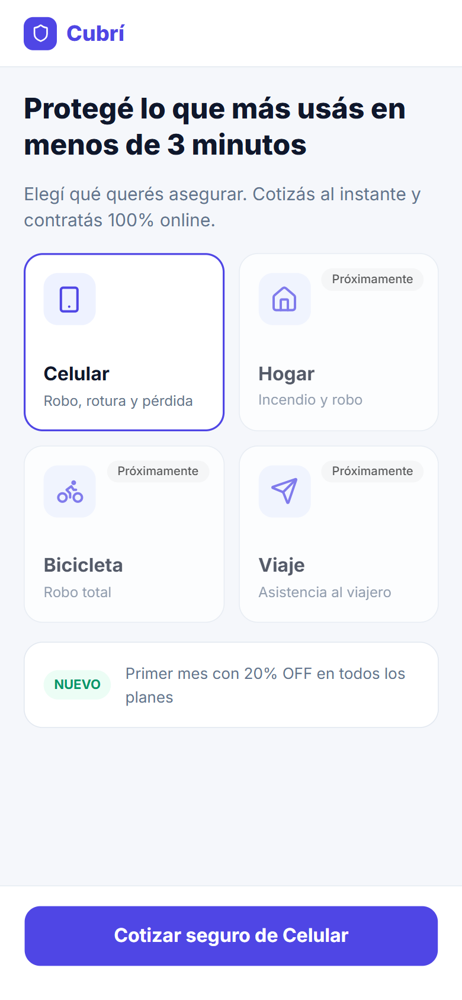 | 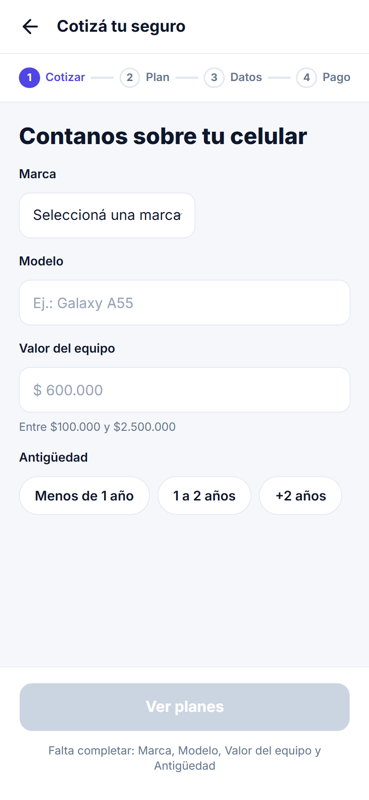 | 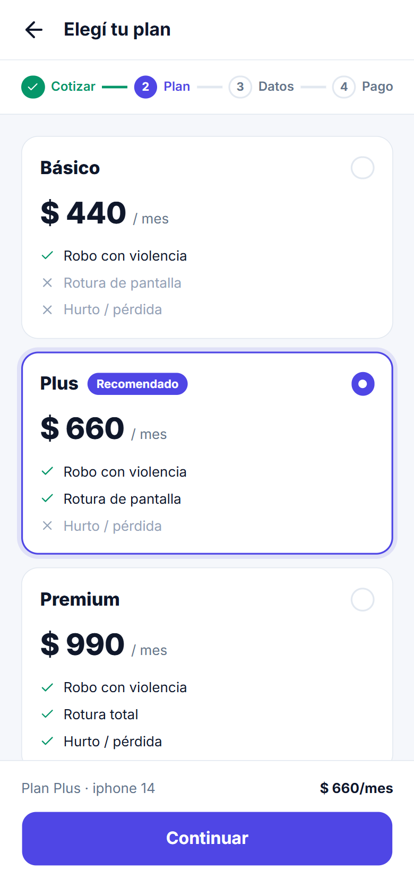 | 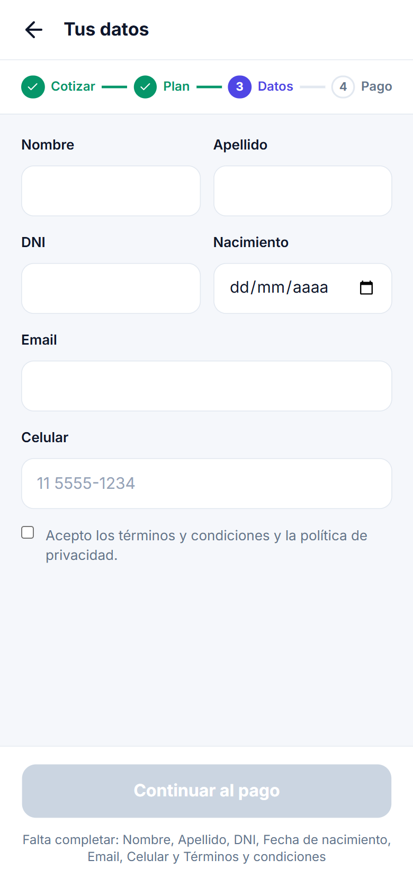 |

| 05 · Pago | 06 · Éxito | 07 · Error de pago |
|---|---|---|
| 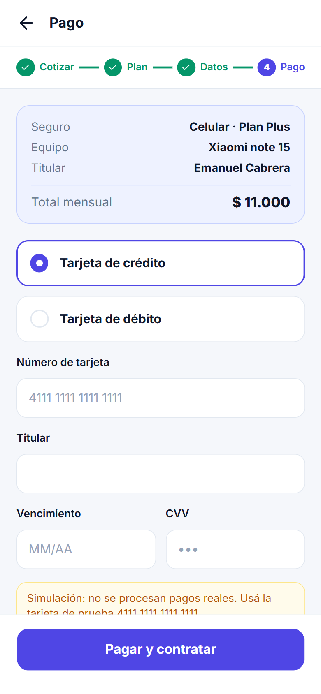 | 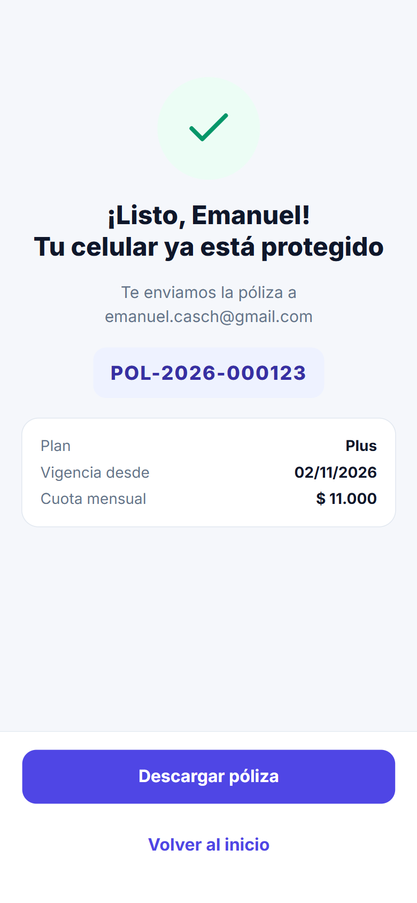 | 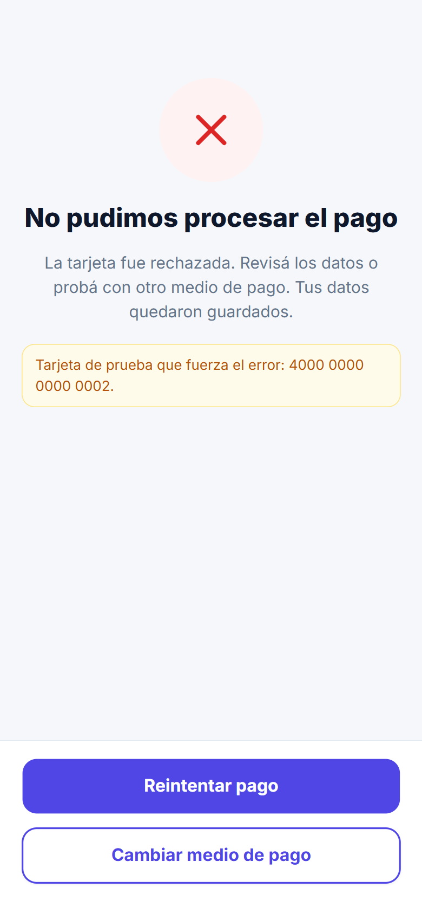 |

### Desktop (1440 px)

| 01 · Inicio | 02 · Cotizar |
|---|---|
| 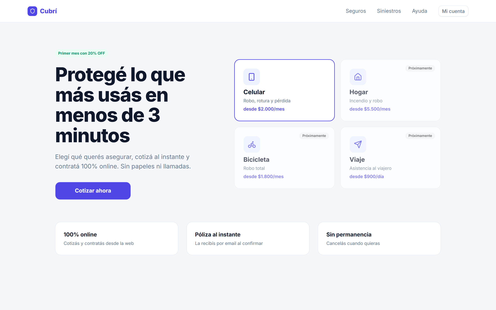 | 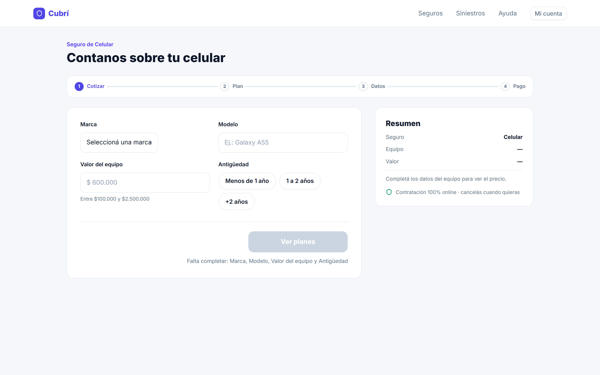 |

| 03 · Elegir plan | 04 · Datos |
|---|---|
| 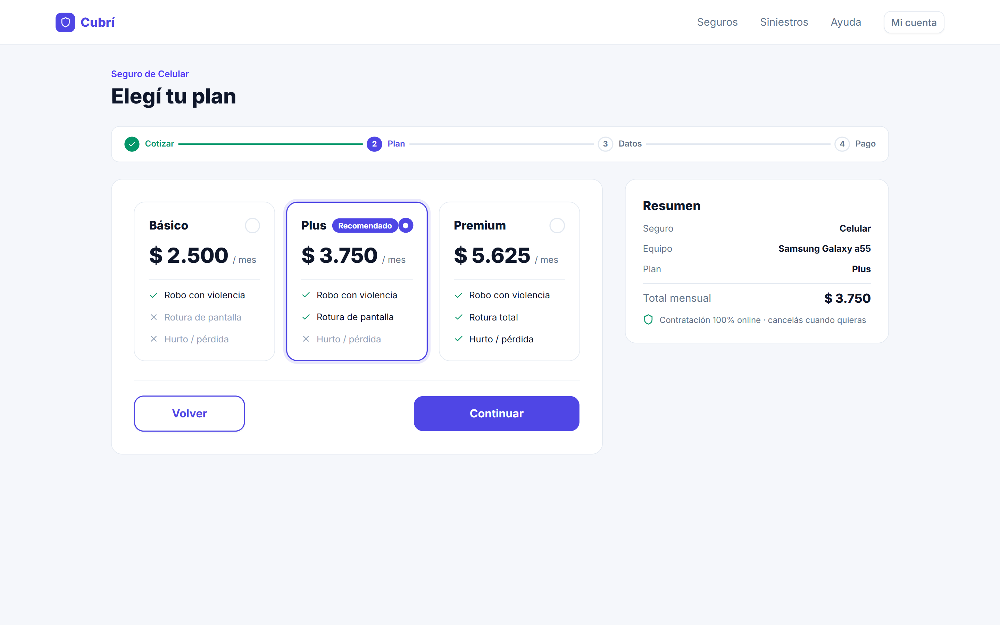 | 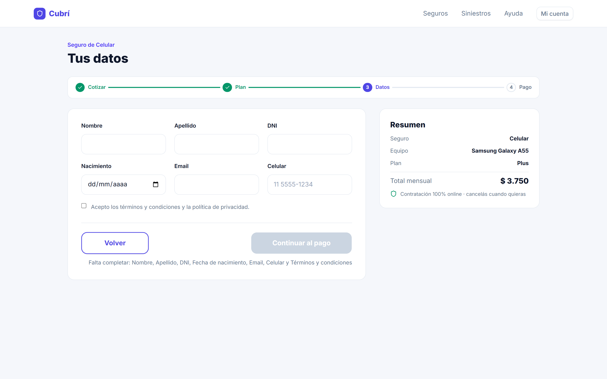 |

| 05 · Pago | 06 · Éxito | 07 · Error de pago |
|---|---|---|
| 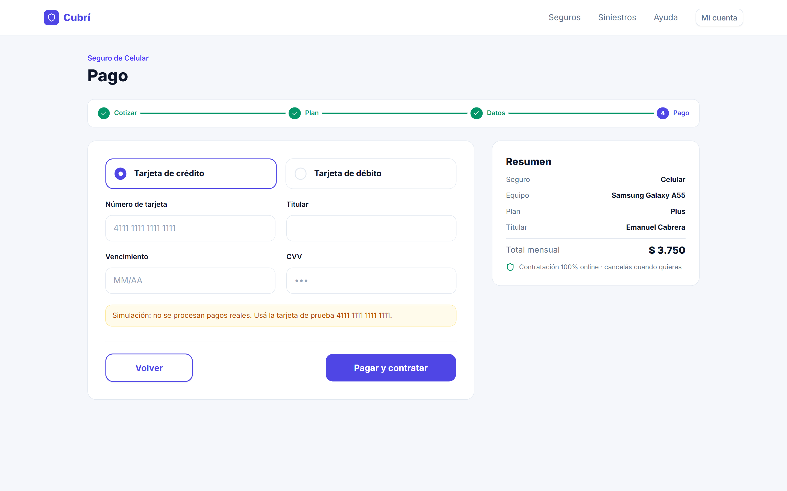 | 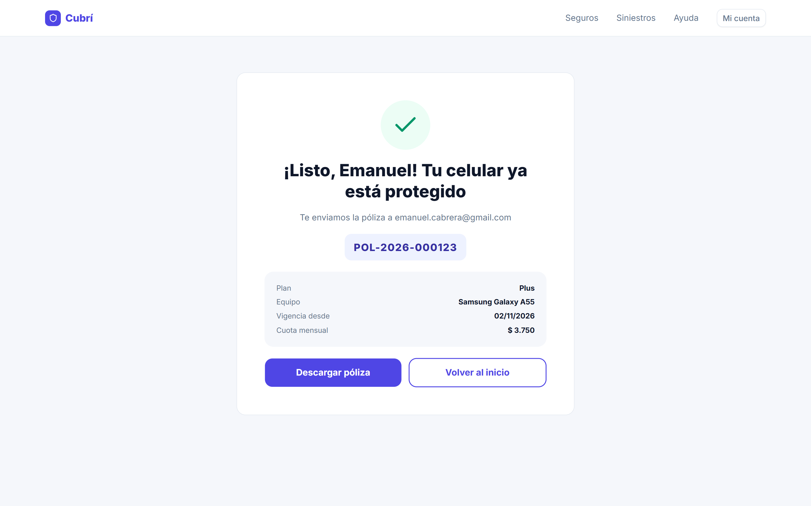 | 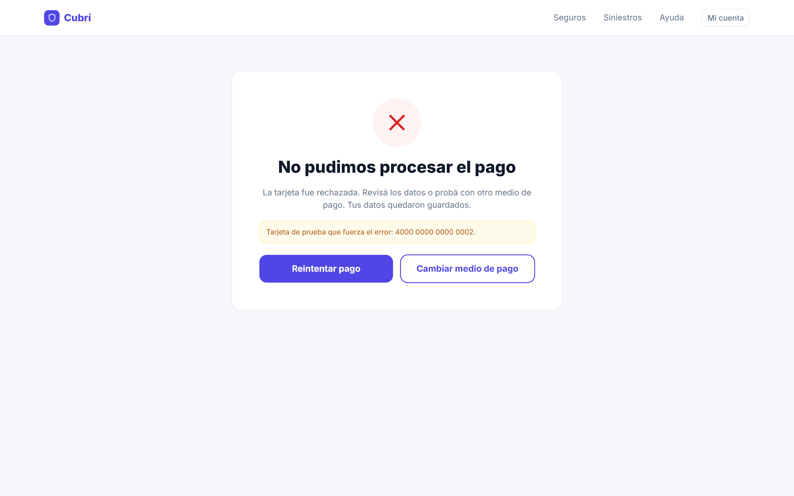 |

## Bonus realizados

_Ninguno por ahora._ <!-- completar si se hacen: persistencia, editar desde el resumen, toast, máscaras, modo oscuro -->

## Créditos

Diseño en Figma provisto por la cátedra · [Basecoat UI](https://basecoatui.com) (MIT) · [Tailwind CSS](https://tailwindcss.com) (MIT) ·
[Lucide](https://lucide.dev) (ISC) · [Inter](https://rsms.me/inter/) (OFL).
